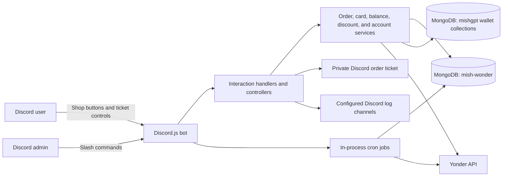
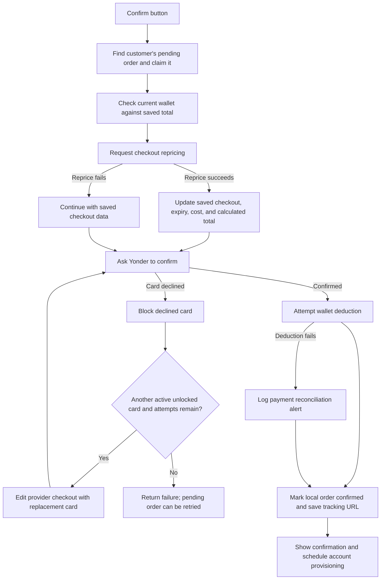

# Mish-Wonder

Mish-Wonder is a TypeScript Discord bot for creating and confirming Wonder
orders from a cart code. It integrates with the Yonder API for checkout and
account-chain operations, reads customers' balances from the MishGPT wallet
database, and manages the payment-card pool and private order tickets.

The bot creates a checkout for review; the provider order is not confirmed until
the customer presses **Confirm Order**. MongoDB stores order and card records,
while wallet balances are stored in a separate database on the same MongoDB
connection.

## Contents

- [Features](#features)
- [Architecture](#architecture)
- [Technology stack](#technology-stack)
- [Project structure](#project-structure)
- [Order workflow](#order-workflow)
- [Wallet, pricing, and payment cards](#wallet-pricing-and-payment-cards)
- [Chain and account management](#chain-and-account-management)
- [Discord commands and interactions](#discord-commands-and-interactions)
- [Database layout](#database-layout)
- [External integrations](#external-integrations)
- [Installation and configuration](#installation-and-configuration)
- [Scripts and running the bot](#scripts-and-running-the-bot)
- [Logging, scheduled jobs, and errors](#logging-scheduled-jobs-and-errors)
- [Security and operational considerations](#security-and-operational-considerations)
- [Troubleshooting](#troubleshooting)
- [License](#license)

## Features

- Guild slash commands for shop setup, card-pool administration, discounts,
  ticket cleanup, and earnings summaries.
- A Components V2 shop panel with cart-code checkout and wallet-balance buttons.
- Private per-order ticket channels with checkout review, confirmation, and
  cancellation controls.
- Checkout creation, repricing, confirmation, cancellation, and card-retry
  requests through Yonder.
- MongoDB-backed orders, encrypted card numbers and CVVs, order discounts, and
  card-lock reconciliation.
- Wallet balance checks and deductions in the MishGPT database.
- Chain selection and scheduled account provisioning through Yonder.
- Discord success/error-channel logging and console startup/error output.

## Architecture



`src/index.ts` creates a Discord client with the `Guilds` intent, registers the
interaction handler, connects to MongoDB, starts the three scheduled jobs, and
then logs in to Discord. The primary models use the `mish-wonder` database;
wallet models select the `mishgpt` database through the same Mongoose connection.

The interaction handler routes slash commands, button custom IDs, and the order
modal to controllers. Controllers coordinate the provider-facing services,
MongoDB models, and Discord UI builders. Account-chain and checkout HTTP calls
are made by the services rather than directly by the interaction handler.

## Technology stack

- Node.js with ECMAScript modules and TypeScript (`NodeNext` module resolution).
- Discord.js 14 for the Discord client, guild slash commands, modals, buttons,
  channels, and Components V2 responses.
- Mongoose 9 and MongoDB for order/card/settings data and wallet access.
- Axios for Yonder API requests.
- `node-cron` for periodic order expiry, card reconciliation, and account
  provisioning.
- `dotenv` for local environment loading; `chalk` and `figlet` for console
  output.

The package manifest does not declare a minimum Node.js version. Use a Node.js
runtime compatible with the installed TypeScript and dependency versions.

## Project structure

```text
logs/
  printLogs.ts                 Console formatting helpers
src/
  commands/                    Guild slash-command definitions
  config/                      Environment and MongoDB configuration
  constants/                   Admin, retry, chain, and order-error constants
  controllers/                 Discord interaction workflows
    order/                     Create, confirm, cancel, and ticket commands
  handlers/                    Discord interaction dispatch
  helpers/                     Order-ticket creation and deletion
  jobs/                        Cron-based expiry and provisioning jobs
  models/                      Mongoose models and schemas
  services/                    Provider, wallet, card, and discount operations
  test/                        Standalone database/API utility scripts
  types/                       Shared TypeScript types
  ui/                          Shop, checkout, confirmation, and response UI
  utils/                       Encryption, chain selection, validation, logging
  deploy-commands.ts            Guild slash-command registration
  index.ts                      Application entry point
```

`dist/` is generated by the TypeScript build and is ignored by Git. The
`package.json` start script runs `dist/src/index.js`.

## Order workflow

### Checkout creation

1. A customer selects **Place Order** in the posted shop panel and submits a
   six-character cart code in a modal.
2. The bot requires an existing wallet balance of at least $1 and limits each
   customer to two pending orders.
3. It selects an active, unlocked card (pinned cards sort first), chooses a
   chain, and asks Yonder to create a checkout.
4. If the provider reports a card payment failure, the bot blocks that card and
   retries using other active, unlocked cards until payment succeeds, no card
   remains, or the retry counter reaches its configured limit of nine.
5. The bot applies the configured discount to the provider's subtotal, service
   fee, and delivery fee. It rejects a subtotal below or above the configured
   limits and attempts to cancel the provider checkout in those cases.
6. It stores a pending order, records the provider checkout and expiry, locks
   the selected card, creates a private ticket channel, and posts the checkout
   review panel there.
7. The customer may confirm or cancel from the ticket. The provider order is
   not confirmed during checkout creation.

The configured minimum and maximum are checked against the provider's
**subtotal**, before discount, rather than the calculated customer total.

### Confirmation and card retries



The bot reprices once before the initial provider confirmation and again after
each third failed payment retry. A successful reprice refreshes the checkout
ID, expiry, provider cost, discounted customer total, discount percentage, and
repricing metadata in the order record. The bot shows an **Updating Checkout**
progress message during repricing, then restores the confirmation or payment
retry status message. A reprice failure is logged and confirmation continues
with the locally saved checkout data. Confirmation uses the same nine-count
retry limit as checkout creation.

Before confirmation, the controller atomically marks the local order as
`confirming` to prevent concurrent confirmation attempts.

Provider confirmation is treated as authoritative. After the provider confirms,
the bot unlocks the active card, attempts the wallet deduction, updates the
order to `confirmed`, and displays provider tracking information when supplied.
Wallet deduction or local order-update failures generate reconciliation logs;
they do not automatically reverse the provider order.

### Cancellation and expiry

- A customer cancellation is sent to Yonder first. On provider success, the
  local order becomes `cancelled`, its expiry is cleared, its card is unlocked,
  and the ticket is scheduled for deletion.
- A per-order timeout and a five-minute cron job remove expired pending orders
  and release their card locks when unused.
- The per-order timeout notifies the customer that the checkout expired,
  suggests using the same cart code if it is still valid or a different code,
  and links to the configured shop channel. The notice includes the checkout
  session timeout information.
- A second five-minute job finds cards still marked locked without an active
  pending checkout and unlocks them.
- Order and card schemas also define MongoDB TTL indexes on their expiry fields.

Order statuses defined by the schema are `pending`, `confirmed`, `failed`,
`cancelled`, and `unknown`. The normal controller paths create pending orders,
mark successful confirmations, or mark customer cancellations; the schema's
`failed` and `unknown` values are not normal outcomes of those paths.

## Wallet, pricing, and payment cards

### Wallet and pricing

- Wallet balances are stored as integer cents (`BigInt`) in the
  `mishgpt.wallet_accounts` collection. Discord user IDs are used as wallet
  account IDs.
- The shop's **Check My Balance** button reads the balance; this bot does not
  implement wallet creation, deposits, or a deposit command.
- The order discount is stored in the `settings` collection under the
  `order-discount` key. If no setting exists, the service initializes it to
  55%. Admin commands can set a percentage from 0 through 100.
- The customer total is calculated from subtotal + service fee + delivery fee,
  less the discount. Taxes, tip, referral, and provider credit are not included
  in this calculation.
- On confirmation, the bot checks the wallet against the saved total and, after
  provider confirmation, uses a conditional MongoDB update that deducts cents
  only if the balance is still sufficient.
- If that deduction fails after the provider has confirmed, the order is still
  recorded as confirmed and an alert is sent to the configured error channel.
  The current confirmation controller does not use the separate
  `deductBalanceOnce` transaction helper or write a wallet-deduction record.

### Payment-card pool

- Administrators add one card at a time or upload a text file with one card
  record per line. Accepted record formats are:

  ```text
  card-number|MM/YY-or-MM/YYYY|CVV|address|city|state|postal-code
  card-number|MM/YY-or-MM/YYYY|CVV|full-name|address|city|state|postal-code
  ```

- Card numbers and CVVs are encrypted with AES-256-GCM using a random
  12-byte IV and an authentication tag. `ENCRYPTION_KEY` must be a
  Base64-encoded 32-byte key.
- The last four digits, expiry, name, address, city, state, and postal code are
  stored as separate card fields; those fields are not encrypted by the card
  encryption helper.
- Checkout selection uses active, unlocked cards and sorts pinned cards first.
  A declined card is marked `blocked`; successful confirmation releases its
  lock and records the last user.
- The card schema supports `active`, `inactive`, `expired`, and `blocked`
  statuses. It also has a TTL expiry field. Pinning exists as a service helper,
  but no pin/unpin slash command is registered.

## Chain and account management

For normal checkout creation, `getBestChain("most_unused_credit")` fetches
chains and accounts from Yonder. It considers chains that are ready, unlocked,
and not in the excluded-chain list, then aggregates positive credit from
accounts marked as orderable. The preferred strategy selects the chain with the
most credit not already in an active order. If that strategy cannot select a
chain, the implementation tries other credit/unused-count strategies before
falling back to the most recently stored `UserChain.lastChain`, or `"2"` if no
usable stored value is found.

After an order is confirmed, the bot associates the user with the newest
unassigned local `UserChain` record when available, then schedules account
creation shortly afterward. It chooses a chain, requests enough accounts to
bring the local count toward three (or requests one for chain `"1"`), waits for
queued provider jobs by polling their status every five seconds, and records
the chain locally after successful account creation.

A separate cron job runs every five minutes. It checks Yonder's chain
readiness/account/unused counts and requests enough accounts to address the
minimum-three and unused-account conditions. It skips excluded chain `"1"`.
The cron job has an in-process overlap guard; it is not a distributed lock
across multiple bot instances.


## Discord commands and interactions

Slash commands are registered to the configured guild with
`npm run deploy:commands`.

| Command | Purpose |
| --- | --- |
| `/ping` | Check that the bot responds and send a success log. |
| `/post-shop` | Post the shop panel in the configured shop channel. |
| `/add-card card-info` | Add one validated card record. |
| `/add-bulk-cards file` | Import valid records from a `.txt` attachment. |
| `/delete-card last-four` | Delete a card by its last four digits. |
| `/delete-all-cards` | Delete all card records. |
| `/set-discount percentage` | Set the order discount from 0 to 100. |
| `/get-discount` | Show the current order discount. |
| `/close-order` | Close a ticket channel in the configured ticket category. |
| `/close-all-orders` | Delete ticket channels in the configured category. |
| `/earnings mode` | Summarize confirmed orders for a selected period. |

Most administrative handlers check a source-code allowlist of Discord user IDs;
the command definitions also set Discord's default `ManageGuild` permission.
`/close-order` is scoped to the ticket category and has the Discord permission
setting, but does not call the allowlist middleware. `/close-all-orders` checks
the allowlist. Earnings periods include rolling 24-hour/7-day/30-day/365-day
ranges and calendar day/week/month/year ranges in the `Asia/Kolkata` timezone.
The bot-owner account receives a profit figure; other authorized users see
order count and sales totals.

The shop panel exposes these non-slash interactions:

- **Place Order** opens the cart-code modal.
- **Check My Balance** displays the wallet balance ephemerally.
- **Confirm Order** and **Cancel Checkout** act on the pending checkout in the
  ticket. The order lookup is scoped to the interacting Discord user.
- If confirmation cannot find the local order, the bot responds that the order
  is unavailable.

The bot also supports ticket-channel deletion after cancellation and the
`/close-order` delay. `/close-all-orders` deletes ticket channels; it does not
cancel provider checkouts or update order records.

## Database layout

The application connects to MongoDB using `MONGODB_URI`, selecting
`mish-wonder` as its default database. Wallet models switch to `mishgpt` on the
same connection.

| Model / collection | Purpose and notable fields |
| --- | --- |
| `Order` | Discord user, provider checkout/order IDs, total, provider cost, discount percentage, status, expiry, confirmation lock, card reference, repricing metadata, and tracking URL. `checkoutId` is unique; user, status, card, and expiry are indexed. |
| `Card` | Encrypted card number/CVV, last four digits, billing fields, active/blocked state, lock state, pin flag, last user, and expiry. |
| `UserChain` | Local `lastChain` and optional Discord user association; timestamps support recent-record selection. |
| `DiscountSetting` (`settings`) | The `order-discount` percentage record in the default database. |
| `WalletAccount` (`wallet_accounts`) | Existing MishGPT wallet data, including account ID and balance cents. |
| `WalletDeduction` (`wallet_deductions`) | Schema used by the idempotent wallet-deduction helper; the current confirmation controller does not write these records. |

Orders and cards use Mongoose timestamps. Order-to-card references use the
`Card` model's MongoDB ObjectId. Wallet collections are configured with
automatic index creation disabled; the wallet account schema also disables
automatic collection creation.

## External integrations

### Yonder API

`YONDER_API_BASE_URL` is the base URL. Requests use the configured
`YONDER_API_KEY` in the Authorization header. Runtime workflows call:

| Method | Path | Usage |
| --- | --- | --- |
| `POST` | `/checkouts` | Create a checkout using cart code, selected card, and chain. |
| `PATCH` | `/checkouts/{checkoutId}` | Replace checkout payment-card details during confirmation retries. |
| `POST` | `/checkouts/{checkoutId}/reprice` | Refresh pricing before order confirmation. |
| `POST` | `/checkouts/{checkoutId}/confirm` | Confirm a customer's checkout. |
| `POST` | `/checkouts/{checkoutId}/cancel` | Cancel a checkout. |
| `GET` | `/chains` | Read chain availability for selection and provisioning. |
| `GET` | `/accounts` | Read accounts and credit for chain selection. |
| `POST` | `/accounts` | Provision account(s) on a chain. |
| `GET` | `/jobs/{jobId}` | Poll queued account-provisioning jobs. |

The service also defines helpers for `/track/{id}`, `/chains/queue`, `/jobs`,
and chain lock/unlock endpoints. Those helpers are not called by the current
interaction or scheduled-job workflows. The confirmation UI uses tracking
information returned in the provider's confirmation response rather than
polling `/track/{id}`.

### Discord

The bot uses guild slash commands and the `Guilds` gateway intent. It creates
private guild text channels under the configured order-ticket category, sends
Components V2 panels, and posts success/error logs to configured channels.
Command deployment uses Discord's REST API for the configured application and
guild.

## Installation and configuration

### Requirements

- Node.js and npm. The repository does not pin a Node.js version.
- A Discord application/bot and a guild for guild-scoped command registration.
- A MongoDB deployment containing or able to access the `mish-wonder` and
  `mishgpt` databases/collections.
- Yonder API access and an API key.
- A Discord shop text channel, order-ticket category, and success/error log
  channels. The bot needs the guild/channel permissions required to send
  messages, create/manage ticket channels, and respond to interactions.

### Install

```bash
npm ci
cp .env.example .env
```

Fill in the local `.env` with the configuration below. `.env` is ignored by
Git; keep credentials and payment-encryption keys out of source control.

### Environment variables

| Variable | Required | Purpose |
| --- | --- | --- |
| `DISCORD_TOKEN` | Yes | Bot token used to log in and register commands. |
| `CLIENT_ID` | Yes | Discord application ID used for guild command registration. |
| `GUILD_ID` | Yes | Guild receiving the registered slash commands. |
| `SHOP_CHANNELID` | Yes | Channel where `/post-shop` publishes the shop panel. |
| `ORDER_TICKET_CATEGORY_ID` | Yes | Parent category for private order tickets. |
| `SUCCESS_CHANNEL_ID` | Yes | Discord channel for success/order logs. |
| `ERROR_CHANNEL_ID` | Yes | Discord channel for error and reconciliation logs. |
| `YONDER_API_BASE_URL` | Yes | Base URL for the Yonder API; `.env.example` supplies an example URL. |
| `YONDER_API_KEY` | Yes | Yonder API credential sent in the Authorization header. |
| `MONGODB_URI` | Yes | MongoDB connection string. |
| `ENCRYPTION_KEY` | Yes | Base64 encoding of exactly 32 bytes for AES-256-GCM card encryption. |
| `MINIMUM_ORDER_SUBTOTAL` | No | Minimum provider subtotal; code default is `20`. |
| `MAX_ORDER_SUBTOTAL` | No | Maximum provider subtotal; code default is `25`. |
| `NODE_ENV` | No | Defaults to `development`; currently printed in startup output. |

The numeric settings must be finite and non-negative. The example environment
file sets the minimum and maximum provider subtotals to 20 and 25, respectively;
both values are read by the order-creation flow.

## Scripts and running the bot

The scripts are defined in `package.json`:

| Command | Description |
| --- | --- |
| `npm run dev` | Run `src/index.ts` with `tsx` watch mode. |
| `npm run build` | Compile TypeScript into `dist/`. |
| `npm start` | Run the compiled entry point at `dist/src/index.js`. |
| `npm run deploy:commands` | Register slash commands to `CLIENT_ID` / `GUILD_ID`. |
| `npm run typecheck` | Run `tsc --noEmit`. |

Typical local development:

```bash
npm run deploy:commands
npm run dev
```

Typical compiled run:

```bash
npm run build
npm start
```

There is no `test` script in `package.json`. Files under `src/test/` are
standalone scripts that connect to external systems; they are not a safe,
isolated test suite. In particular, some can print decrypted card data or
modify a wallet balance, so do not run them against live data without reviewing
their effects and configuring an appropriate test environment.

## Logging, scheduled jobs, and errors

- Startup and routine console output uses helpers in `logs/printLogs.ts`.
- Success and error details can be sent to the configured Discord log channels.
- Interaction errors are mapped to user-facing responses; application error
  logging sanitizes some credential/card-like patterns.
- Global uncaught exceptions and unhandled promise rejections trigger shutdown
  handling, set a failing exit status, destroy the Discord client, and
  disconnect MongoDB.
- Three in-process cron jobs run every five minutes: expired-order cleanup,
  stale-card-lock reconciliation, and chain account provisioning.
- Account provisioning jobs returned as queued by Yonder are polled every five
  seconds until the provider reports completion or failure.

The cron jobs run inside each bot process. The overlap guard for provisioning
is process-local, so multiple simultaneously running instances may execute
scheduled work independently.

## Security and operational considerations

- Treat `DISCORD_TOKEN`, `YONDER_API_KEY`, `MONGODB_URI`, and `ENCRYPTION_KEY` as
  secrets. Keep `.env` and database backups private.
- Back up `ENCRYPTION_KEY` securely. Existing encrypted card values cannot be
  decrypted if the matching key is lost or changed.
- Card numbers and CVVs are encrypted, but other identifying/billing fields
  are stored in plaintext. Restrict database and backup access accordingly.
- Administrative authorization includes a Discord user-ID allowlist in source
  code. Update and review that allowlist through the normal source-control
  process; do not rely only on command visibility settings.
- Some standalone scripts under `src/test/` can reveal decrypted card data or
  make persistent wallet changes. They are not a general-purpose test runner.
- The application has logging and reconciliation alerts for wallet or database
  failures after provider confirmation, but no automatic compensation or
  reconciliation worker for those cases.
- No Dockerfile, deployment manifest, CI pipeline, or runtime version pin is
  present in the repository. Deployment must provide the runtime, environment
  variables, MongoDB access, and Discord/Yonder connectivity externally.

## Troubleshooting

| Symptom | Checks |
| --- | --- |
| Bot fails during startup | Confirm all required environment values are present, MongoDB is reachable, and the Discord token is valid. |
| Slash commands are missing | Run `npm run deploy:commands` with the intended `CLIENT_ID` and `GUILD_ID`; commands are registered to one guild. |
| `/post-shop` cannot post | Check `SHOP_CHANNELID`, bot access to that channel, and the invoking user's command authorization. |
| Ticket creation fails | Verify `ORDER_TICKET_CATEGORY_ID`, that the category exists in the interaction guild, and that the bot can create/manage channels. |
| Checkout creation fails | Check the cart code, Yonder base URL/API key, provider availability, and that an active unlocked card is available. |
| Confirmation reports insufficient funds | Check the wallet account in `mishgpt.wallet_accounts`; a wallet must exist and have enough cents for the saved order total. |
| Payment retry cannot continue | Check that another active, unlocked card exists; declined cards are marked blocked. |
| Card remains locked | The expiry and reconciliation jobs run every five minutes; inspect pending orders and the error logs if it remains locked. |
| Account provisioning is not visible | Check Yonder chain/account responses and queued job status; provisioning is periodic and also scheduled after a successful order. |

## License

This project is distributed under the [MIT License](./LICENSE).
